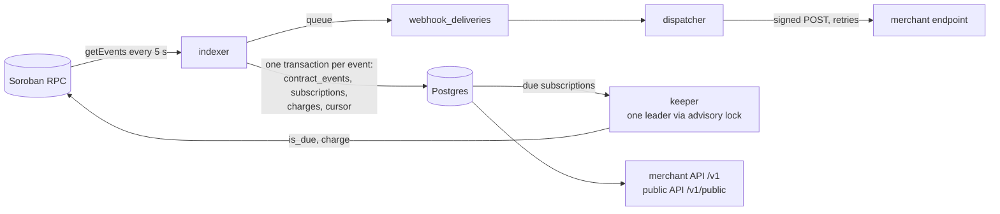

# lumensub-backend

The service that watches the [LumenSub contract](https://github.com/lumensub/lumensub-contracts),
nudges it when payments come due, and tells merchants what happened. It turns contract
events into Postgres tables, runs a keeper that calls `charge`, serves a merchant API, and
posts signed webhooks.

It holds no funds and signs for nobody except its own keeper account. We built it so that
losing it would be an inconvenience, not an outage: every subscription lives on chain and
anyone can call `charge`. If you only remember one thing about this repo, make it that.

## One subscription, as this service sees it

Alice subscribes to plan 4: 10 USDC every 30 days, a 7-day trial, a 3-day grace period. The
contract was deployed with the defaults, 1% protocol fee and 0.5% keeper reward. Say she
signs up at 09:00 UTC on 1 March 2026, as subscription 12.

**Day 0.** The indexer, polling `getEvents` every 5 seconds, sees `sub_new`. It calls
`get_subscription(12)` for the details the event doesn't carry, writes a row with status
`trialing` and `next_charge_at` of 8 March 09:00, and queues `subscription.created` for each of
the merchant's webhook endpoints. MRR doesn't move yet; it counts `active` and `past_due`
subscriptions only.

**Day 7.** The keeper's query (`status IN (trialing, active, past_due) AND next_charge_at <= now()`)
picks up subscription 12. It asks the contract `is_due(12)` first, because the read model can
trail the chain by a few ledgers and a rejected charge still costs a fee. Then it submits
`charge`. It writes nothing to `subscriptions` itself. The `charged` event comes back
through the indexer like everything else, and the merchant receives:

```http
POST /lumensub-hook HTTP/1.1
Content-Type: application/json
User-Agent: LumenSub-Webhooks/1
LumenSub-Event: subscription.charged
LumenSub-Delivery: 731
LumenSub-Signature: t=1772960412,v1=8d0c6a43f1...

{
  "id": "0000051539611648-0000000001",
  "type": "subscription.charged",
  "created_at": "2026-03-08T09:00:06.000Z",
  "ledger": 1200042,
  "tx_hash": "5b1c...",
  "data": {
    "sub_id": "12",
    "amount": "100000000",
    "fee": "1000000",
    "keeper_reward": "500000",
    "cycle": 1,
    "next_charge_at": "2026-04-07T09:00:00.000Z"
  }
}
```

Amounts are strings in the token's smallest unit, so 10 USDC is `"100000000"`: 9.85 to the
merchant, 0.10 fee, 0.05 to our keeper. `v1` is a hex HMAC-SHA256 of `"<t>.<raw body>"` keyed
with the endpoint's `whsec_...` secret. MRR for that token is now `"100000000"`.

**Day 37.** The same again, cycle 2, next charge 7 May.

**Day 67.** Alice has 4 USDC. The charge transaction lands, but the contract returns 0 and
publishes `chg_fail`. The keeper sees the 0, reads the subscription, finds it past due, and
records the attempt as `declined` in `keeper_attempts`. It then backs off: about a minute,
then two, then four, doubling with jitter up to a cap of six hours. Without that, it would
pay fees every minute for three days, because a failed charge doesn't move
`next_charge_at`. The webhook is:

```json
{
  "id": "0000051668484096-0000000003",
  "type": "subscription.charge_failed",
  "created_at": "2026-05-07T09:00:05.000Z",
  "ledger": 1730416,
  "tx_hash": "9e4f...",
  "data": { "sub_id": "12", "reason": "balance", "status": "past_due" }
}
```

`reason` is `balance` or `allowance`, which is what a merchant usually wants to show the
customer.

**Day 70 and after.** The first retry after the grace period ends fails again, and the
contract marks the subscription lapsed. With the six-hour cap, that happens within six
hours of the grace period ending. Merchants get another `subscription.charge_failed`, this
time with `"status": "lapsed"`. The status is final, so the keeper's query stops returning
the subscription. If Alice had topped up on day 69, the next retry would have
succeeded, the `charged` event would have cleared the backoff, and her next charge would be
30 days from that payment.



The arrow that matters is the missing one: nothing goes from the keeper to Postgres except
its own attempt log. State only enters through the indexer.

## Design decisions

**The chain is the source of truth.** The indexer is the only writer of subscription state,
so the whole read model can be rebuilt by truncating the tables and resetting the cursor.
Each event is applied in one transaction together with the cursor update, and its id goes
into `contract_events` first, so a replayed page is a no-op. Updates to a subscription carry
`WHERE updated_ledger <= $ledger`, which stops an older event from overwriting a newer one.

**Billing doesn't depend on us.** The keeper is off unless `KEEPER_ENABLED=true`, and the
contract pays any caller the keeper reward, so a merchant who never runs this service still
gets paid if someone else keeps charging. We run one because a reliable default matters.

**One keeper at a time, many workers.** The keeper takes a Postgres advisory lock before
each pass. You can run several workers for availability, and only the lock holder charges.
If two keepers anywhere call `charge` on the same subscription, the contract rejects the
second with `NotDue` and the only cost is a transaction fee.

**API keys are hashed, and with SHA-256 rather than bcrypt.** A key is `lsk_` plus 24 random
bytes. We store its SHA-256 and the first 12 characters, so a leaked database gives you
nothing you can use and the dashboard can still show which key is which. Slow hashes exist
to protect guessable passwords. These keys are 192 bits of randomness, and a fast hash lets
us look a key up by hash on every request.

**Webhooks are at-least-once and signed with a timestamp.** Merchants de-duplicate on `id`,
which is the on-chain event id. The timestamp in the signature lets receivers refuse
replays older than five minutes. Endpoints must be HTTPS and resolve to public addresses,
and we don't follow redirects, because a redirect could point at the private address we
just refused.

**Plain SQL.** Eight migrations in `migrations/`, applied in order by a runner of about 70 lines, and
queries written by hand. The schema is small enough that an ORM would hide more than it
saved.

## Things we chose not to do

- No custody and no signing for merchants or subscribers. The app does that in the user's
  wallet.
- No exactly-once webhook delivery. It would need cooperation from every receiver;
  de-duplicating on `id` is simpler and honest.
- No email provider. Notifications go through a `Notifier` interface, and the worker wires
  the logging one. An `EmailNotifier` exists but takes a transport you supply.
- No token metadata yet. The API returns token contract ids; symbols and decimals are on the
  roadmap.

## Questions we get

**Can this service take more than the plan price?** It can't take anything. The keeper
calls `charge`, and the contract decides the amount: the plan price minus credit, once per
period, capped by the subscriber's allowance on the token.

**What happens if it goes down?** Billing continues if any other keeper is running, and
stops being retried if none is. Nothing is lost: when the worker comes back, the indexer
resumes from its cursor (`indexer_cursor`), and due subscriptions are still due. If the RPC
has dropped the ledgers we missed, the indexer logs `RPC no longer has the cursor ledger`,
and [docs/operations.md](docs/operations.md) explains how to re-index.

**Can a subscriber cancel without going through us?** Yes, directly on the contract. The
indexer sees `cancelled` and updates the row; the merchant gets `subscription.cancelled` with
`data.by` set to whoever signed.

**What happens to the subscriber's allowance after they cancel?** Nothing we control. It
lives on the token. The contract won't charge a cancelled subscription, and the keeper's
query excludes it.

## Running it

Node 20 or newer, and Docker for Postgres and Redis.

```sh
npm ci
cp .env.example .env    # set SUBSCRIPTION_CONTRACT_ID, from lumensub-contracts' .env.testnet
docker compose up -d    # Postgres 16 and Redis 7, both bound to 127.0.0.1
npm run db:migrate      # prints "applied 001_merchants.sql" ... "applied 008_keeper_declined.sql"
npm run dev             # API on http://localhost:8080, OpenAPI UI at /docs
npm run dev:worker      # indexer and webhook dispatcher; add KEEPER_ENABLED=true and KEEPER_SECRET to charge
```

Merchant routes need a key. The first one comes from the CLI, later ones from the API:

```sh
npm run keys:create -- GABC...YOUR_MERCHANT_ADDRESS laptop
# API key for GABC... (laptop):
#
#   lsk_3f9a...
#
# Store it now. Only its hash is kept.
curl -H "Authorization: Bearer lsk_3f9a..." http://localhost:8080/v1/merchant
```

`npm test` runs 140 tests, including SQL tests that apply every migration to PGlite (Postgres
compiled to WebAssembly), so you don't need Docker for them. CI runs lint, typecheck,
tests, the build, and the migrations against a real Postgres 16.

Every environment variable is validated at startup, and a bad value stops the process with
its name. The full list is in [.env.example](.env.example); the ones you'll touch are
`DATABASE_URL`, `SUBSCRIPTION_CONTRACT_ID`, `STELLAR_RPC_URL`, `STELLAR_NETWORK_PASSPHRASE`,
`KEEPER_ENABLED` and `KEEPER_SECRET`. Leave `WEBHOOK_ALLOW_PRIVATE_TARGETS` off outside local
development.

More detail: [architecture](docs/architecture.md), [API](docs/api.md),
[webhooks, with verification code for Node and Python](docs/webhooks.md),
[indexer](docs/indexer.md), [operations](docs/operations.md).

## Status

Testnet only, unaudited, and the API may change before 1.0. There's no hosted instance;
run your own against a contract you deployed.

The same checklist appears in all three repos:

- [x] Subscription contract: trials, grace periods, pause and resume, plan changes with credit, refunds
- [x] Revenue splitter
- [x] Backend: indexer, keeper, merchant API, signed webhooks
- [x] App: merchant dashboard, hosted checkout, subscriber portal, `@lumensub/sdk`
- [ ] A shared testnet deployment with a published contract id
- [ ] Token symbols and decimals in the backend, so the app can stop showing contract ids
- [ ] `@lumensub/sdk` published to npm
- [ ] An external audit of the contracts, before anything touches mainnet

Issues and pull requests are welcome; [CONTRIBUTING.md](CONTRIBUTING.md) has the details, and
security reports go to [SECURITY.md](SECURITY.md). MIT licensed.
